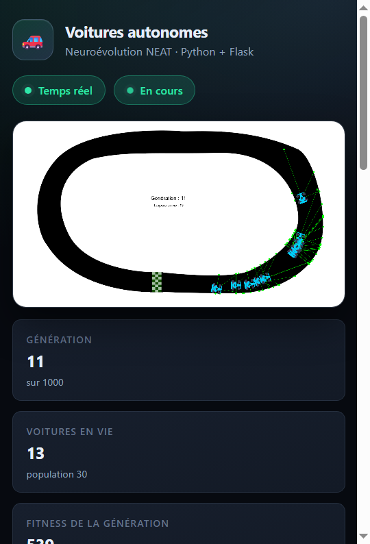

# 🚗 Simulation de voitures autonomes avec NEAT

Application web qui fait **apprendre à conduire** une population de voitures par
neuroévolution (**NEAT**). La physique et l'évolution sont calculées en Python,
le rendu se fait dans le navigateur sur un `<canvas>`.



---

## Sommaire

- [Fonctionnalités](#-fonctionnalités)
- [Stack technique](#-stack-technique)
- [Installation](#-installation)
- [Lancement](#-lancement)
- [Utilisation de l'interface](#-utilisation-de-linterface)
- [Entraînement en ligne de commande](#-entraînement-en-ligne-de-commande)
- [API HTTP](#-api-http)
- [Comment ça marche](#-comment-ça-marche)
- [Refactoring et corrections](#-refactoring-et-corrections)
- [Tests et validation](#-tests-et-validation)
- [Documentation générée](#-documentation-générée)
- [Structure du projet](#-structure-du-projet)
- [Dépannage](#-dépannage)
- [Licence et crédits](#-licence-et-crédits)

---

## ✨ Fonctionnalités

- **Simulation temps réel** : 30 voitures par génération, jusqu'à 1 000 générations.
- **Rendu navigateur** : piste, sprite orienté, radars, textes de la version d'origine.
- **Contrôles complets** : démarrer / pause / reprendre / réinitialiser.
- **Vitesse réglable** : 0.5×, 1×, 2×, 4×, 8× (la physique reste identique, seule la
  cadence change).
- **5 cartes** fournies, changeables à chaud (la simulation redémarre sur la nouvelle piste).
- **Statistiques en direct** : génération, voitures en vie, fitness courante, record,
  cadence, progression de la génération.
- **Courbe d'évolution** de la fitness (meilleure et moyenne) par génération.
- **Meilleur génome sauvegardé automatiquement** dans `runs/` et téléchargeable
  depuis l'interface (pickle neat-python).
- **Flux temps réel SSE** (`/api/stream`) avec repli automatique en sondage HTTP.
- **Mode entraînement headless** (`train.py`) avec la même physique, sans navigateur.
- **26 tests automatisés**, dont une **parité bit à bit** avec l'implémentation
  Pygame d'origine.

---

## 🧰 Stack technique

| Couche | Technologie | Rôle |
| --- | --- | --- |
| Langage | Python 3.10+ (testé 3.12) | moteur de simulation |
| Serveur | Flask 3.1 | pages, API REST, flux SSE, fichiers statiques |
| Évolution | neat-python 2.0 | génomes, espèces, reproduction, stagnation |
| Pixels | Pygame 2.6 (driver `dummy`) | chargement des PNG, collisions, raycasts, rotation des sprites |
| Rendu | HTML + CSS + Canvas 2D | affichage 1920 × 1080, sans dépendance externe |
| Tests | `unittest` (stdlib) | physique, carte, moteur, API, parité |

Aucune ressource externe (CDN, police, framework JS) : l'application fonctionne
hors ligne.

---

## 📦 Installation

```bash
# 1. Récupérer le projet puis :
python -m venv .venv
source .venv/bin/activate          # Windows : .venv\Scripts\activate
pip install -r requirements.txt
```

Dépendances : `Flask`, `neat-python`, `pygame` (versions épinglées dans
`requirements.txt`).

> **Note de compatibilité** : neat-python 2.0 exige la clé
> `no_fitness_termination` dans la section `[NEAT]`. Elle a été ajoutée à
> `config.txt` — sans elle, même le script d'origine ne démarre pas avec cette
> version. La valeur `False` conserve le comportement historique (arrêt par
> `fitness_threshold`, fixé très haut).

---

## ▶️ Lancement

```bash
python app.py
# → http://127.0.0.1:5000
```

Pour exposer le serveur (VM, conteneur, réseau local) :

```bash
HOST=0.0.0.0 PORT=3000 python app.py
```

| Variable | Défaut | Description |
| --- | --- | --- |
| `HOST` | `127.0.0.1` | interface d'écoute |
| `PORT` | `5000` | port d'écoute |
| `SIM_AUTOSTART` | `1` | démarre la simulation au lancement (`0` pour rester en pause) |
| `LOG_LEVEL` | `INFO` | verbosité des logs (`DEBUG` affiche le détail NEAT) |

Le serveur de développement Flask est volontairement lancé avec
`use_reloader=False` : la simulation tourne dans un thread et un rechargement
automatique lancerait deux évolutions concurrentes.

---

## 🖱 Utilisation de l'interface

| Élément | Action |
| --- | --- |
| **Démarrer / Pause / Reprendre** | lance ou met en pause l'évolution |
| **Réinitialiser** | repart de la génération 0 avec une nouvelle population |
| **Vitesse** | 0.5× à 8× — seules les frames par seconde changent |
| **Carte** | 5 pistes 1920 × 1080 ; le changement relance la simulation |
| **Radars** | affiche ou masque les 5 capteurs (vert) |
| **Télécharger le meilleur génome** | fichier `.pkl` réutilisable avec neat-python |

Raccourcis clavier : `Espace` = pause/reprise, `R` = réinitialiser.

Chaque voiture morte est retirée de l'affichage (comme dans la version
d'origine) ; le compteur « Toujours en vie » et la barre de progression
indiquent l'état de la génération.

---

## 🖥 Entraînement en ligne de commande

Le même moteur, sans navigateur, pour produire un génome :

```bash
python train.py --generations 30
python train.py --generations 100 --map map3.png --population 60 --seed 42
python train.py --generations 200 --save runs/meilleur_genome.pkl
```

Sortie par génération :

```text
génération    1 | meilleure    2514.7 | moyenne     173.4 | vivantes   0/ 30 | frames   357 |   1.68s
```

Le meilleur génome est écrit dans `runs/` (pickle). Pour le recharger :

```python
import pickle, neat
genome = pickle.load(open("runs/best_genome.pkl", "rb"))
config = neat.config.Config(neat.DefaultGenome, neat.DefaultReproduction,
                            neat.DefaultSpeciesSet, neat.DefaultStagnation, "config.txt")
net = neat.nn.FeedForwardNetwork.create(genome, config)
```

---

## 🌐 API HTTP

| Méthode | Route | Rôle |
| --- | --- | --- |
| `GET` | `/` | interface web |
| `GET` | `/healthz` | état du serveur et de la simulation |
| `GET` | `/api/config` | cartes, vitesses, paramètres (population, capteurs, actions) |
| `GET` | `/api/state` | instantané complet (voitures, radars, statut) |
| `GET` | `/api/stream` | flux SSE : une frame JSON par événement |
| `GET` | `/api/history` | historique de fitness par génération |
| `POST` | `/api/start` | démarrer ou relancer |
| `POST` | `/api/pause` | mettre en pause |
| `POST` | `/api/resume` | reprendre |
| `POST` | `/api/reset` | réinitialiser |
| `POST` | `/api/settings` | `{"speed": 2}` ou `{"map": "map2.png"}` |
| `GET` | `/api/best-genome` | téléchargement du meilleur génome (`.pkl`) |
| `GET` | `/media/...` | carte et sprite (`/media/maps/map.png`, `/media/car.png`) |

Exemple d'instantané (tronqué) :

```json
{
  "seq": 412, "status": "running", "generation": 3,
  "alive": 17, "population": 30, "frame": 412, "frame_limit": 1200,
  "speed": 1.0, "best_fitness": 2514.67, "current_best": 980.2,
  "map": {"name": "map.png", "width": 1920, "height": 1080, "url": "/media/maps/map.png"},
  "cars": [{"x": 1094.1, "y": 43.2, "angle": 20, "speed": 22, "alive": true,
            "fitness": 412.3, "radars": [[1127, 55, 18], "…"]}]
}
```

---

## 🧠 Comment ça marche

### Perception — 5 capteurs

Cinq rayons partent du centre de la voiture, aux angles **-90°, -45°, 0°, 45°, 90°**
relatifs à son orientation. Chacun avance pixel par pixel (300 px maximum)
jusqu'à rencontrer un **pixel blanc**, qui matérialise la bordure. L'entrée du
réseau est la distance divisée par 30 (5 valeurs entières).

### Décision — 4 actions

Le réseau *feed-forward* produit 4 sorties ; l'action retenue est celle de
valeur maximale :

| Sortie | Action | Effet |
| --- | --- | --- |
| 0 | gauche | `angle += 10°` |
| 1 | droite | `angle -= 10°` |
| 2 | ralentir | `speed -= 2` (jamais sous 12) |
| 3 | accélérer | `speed += 2` |

La vitesse initiale est de 20 px/frame.

### Collision et récompense

Les 4 coins du rectangle orienté sont testés : un pixel blanc (ou une position
hors carte) tue la voiture. La récompense cumulée par frame est
`distance / (60 / 2)` — la fitness d'un génome est la somme de ces récompenses
jusqu'à son crash.

### NEAT

| Paramètre | Valeur | Fichier |
| --- | --- | --- |
| Population | 30 | `config.txt` |
| Activation | `tanh` | `config.txt` |
| Connexions initiales | `full` (5 entrées → 4 sorties) | `config.txt` |
| Mutation des poids | 0.8 | `config.txt` |
| Ajout de connexion / nœud | 0.5 / 0.2 | `config.txt` |
| Seuil de compatibilité (espèces) | 2.0 | `config.txt` |
| Élitisme / seuil de survie | 3 / 0.2 | `config.txt` |
| Stagnation maximale | 20 | `config.txt` |
| Frames max par génération | 1200 | `simulation/settings.py` |
| Générations max | 1000 | `simulation/settings.py` |

Une génération s'arrête dès que **toutes** les voitures sont mortes ou après
1 200 frames, exactement comme dans le script d'origine. NEAT reproduit ensuite
la population (`population.run`), sans intervention du code applicatif.

---

## 🔧 Refactoring et corrections

### Avant / après

| Avant (`main.py`) | Après |
| --- | --- |
| 1 script de ~230 lignes mêlant physique, NEAT et rendu | paquet `simulation/` (6 modules) + `app.py` + front séparé |
| boucle Pygame bloquante, une seule fenêtre | moteur dans un thread, pilotable depuis le navigateur |
| aucune API, aucun test | API REST + SSE, 26 tests automatisés |
| chemins relatifs au répertoire courant | chemins `pathlib` absolus, indépendants du `cwd` |
| `sys.exit()` pour quitter | exception dédiée + arrêt propre du thread |
| état global `current_generation` | état protégé par verrou, instantanés cohérents |

### Bugs corrigés

| Problème | Impact | Correctif |
| --- | --- | --- |
| `no_fitness_termination` absent de `config.txt` | crash immédiat avec neat-python 2.0 | clé ajoutée (`False`, comportement historique) |
| `get_at()` hors de la carte | `IndexError` qui tue le serveur | coordonnées hors carte traitées comme une bordure |
| comparaison de couleur 3 ou 4 canaux | collisions non détectées selon le format de surface | comparaison sur les canaux RGB |
| `BORDER_COLOR` comparé à `get_at()` | dépendait de la profondeur de la surface | normalisé via `Track` |
| `sys.exit(0)` dans la boucle de rendu | arrêt brutal, pas de libération | `SimulationStopped` + `join` du thread |
| compteur de population écrasé par l'objet NEAT | `/api/state` non sérialisable | attributs séparés (`_population` / `_neat_population`) |
| chemins `'car.png'`, `'map.png'` | fonctionne uniquement depuis le bon dossier | `settings.ASSETS_DIR` |
| aucun moyen de réutiliser un bon génome | apprentissage perdu à la fermeture | sauvegarde auto + téléchargement |

> La borne verticale `position[1] = min(position[1], WIDTH - 120)` de l'original
> a été **conservée telle quelle** : la corriger aurait modifié la trajectoire des
> voitures. Les requêtes hors carte étant désormais sûres, elle ne provoque plus
> de crash.

### Améliorations

- **Architecture** : modules courts, typés, documentés en français.
- **Performance** : cache des rotations de sprite (moins d'appels à
  `pygame.transform.rotate`). Mesure A/B sur la même machine : 8,2 ms/frame pour
  l'original, 9,2 ms/frame pour la version refactorée — environ 1 ms de surcoût,
  prix des contrôles de bornes qui évitent les plantages hors carte.
- **Pilotage** : pause, reprise, vitesse et changement de carte sans redémarrer
  le processus ; la physique ne dépend pas de la cadence.
- **Observabilité** : logs structurés (`INFO` = une ligne par génération), plus de
  bruit `pygame` ni de rapporteur NEAT verbeux.
- **Tests** : physique, carte, moteur, API et parité avec l'original.
- **Documentation** : ce README, un PDF technique et une présentation PowerPoint.

---

## ✅ Tests et validation

```bash
python -m unittest discover -s tests -t . -v
```

```text
Ran 26 tests in 2.1s
OK
```

| Module de test | Vérifications |
| --- | --- |
| `test_parity.py` | rejoue les trajectoires enregistrées depuis le `main.py` d'origine (carte réelle : 400 frames, arène : 66 frames, anneau : 400 frames) et compare positions, angles, vitesse, distance, coins, radars, entrées et récompense **au bit près** |
| `test_track.py` | dimensions, bordure blanche, hors limites, validation des noms de carte |
| `test_engine.py` | progression des générations, limite de frames, pause/reprise, reset, génome sauvegardé, validations |
| `test_api.py` | page, configuration, commandes, erreurs 400, SSE, médias, historique, téléchargement |

Les fixtures de parité sont reproduisibles :

```bash
python tools/parity_fixtures.py --legacy /chemin/vers/main.py --assets assets --output tests/fixtures
```

---

## 📚 Documentation générée

| Fichier | Contenu |
| --- | --- |
| [`docs/documentation.pdf`](docs/documentation.pdf) | documentation technique complète (architecture, algorithmes, corrections, API, validation) |
| [`docs/presentation.pptx`](docs/presentation.pptx) | présentation de 15 slides pour une démonstration orale |

Régénération (nécessite `reportlab`, `python-pptx`, `pillow`) :

```bash
pip install reportlab python-pptx pillow
python tools/make_docs.py
```

---

## 🗂 Structure du projet

```text
.
├── app.py                     # serveur Flask (pages, API, SSE)
├── train.py                   # entraînement NEAT headless
├── config.txt                 # configuration NEAT
├── requirements.txt
├── simulation/
│   ├── settings.py            # constantes et chemins (valeurs d'origine)
│   ├── pygame_support.py      # Pygame headless, sprites, cache de rotation
│   ├── track.py               # carte, requêtes pixel sûres
│   ├── car.py                 # physique, capteurs, récompense
│   ├── evaluation.py          # boucle d'évaluation d'une génération
│   └── engine.py              # thread NEAT, pause, vitesse, instantanés
├── templates/index.html       # interface
├── static/css/style.css
├── static/js/app.js           # canvas, SSE, graphique, contrôles
├── assets/
│   ├── car.png
│   └── maps/map*.png          # 5 pistes 1920x1080
├── tests/                     # 26 tests + fixtures de parité
├── tools/
│   ├── make_docs.py           # génère PDF + PowerPoint
│   └── parity_fixtures.py     # régénère les fixtures depuis l'original
├── docs/                      # documentation.pdf, presentation.pptx
└── runs/                      # meilleur génome + logs
```

---

## 🩺 Dépannage

| Symptôme | Cause probable | Solution |
| --- | --- | --- |
| `ModuleNotFoundError: flask` | dépendances non installées dans l'environnement actif | `pip install -r requirements.txt` |
| `ModuleNotFoundError: pygame` au démarrage | environnement virtuel non activé | activer `.venv` |
| `RuntimeError: Missing required configuration item` | `config.txt` ancien (sans `no_fitness_termination`) | utiliser le `config.txt` fourni |
| page blanche | API non joignable | vérifier `/healthz`, puis la console du navigateur |
| pas de mise à jour en direct | proxy qui bufferise le SSE | l'interface bascule automatiquement en sondage |
| génération très longue | 30 voitures, 1 200 frames | augmenter la vitesse (×4, ×8) |
| port 5000 occupé (macOS) | AirPlay Receiver | `PORT=5001 python app.py` |

En cas d'erreur du moteur, le message est affiché dans le panneau « Erreur du
moteur » de l'interface et détaillé dans `runs/server.log`.

---

## 📄 Licence et crédits

**Alex Alkhatib**, licence MIT (voir [`LICENSE.md`](LICENSE.md)).
